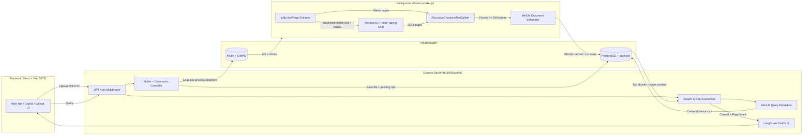

# IntelliCore — Enterprise Knowledge Intelligence & RAG Platform

> **Document Ingestion with Automatic Per-Page PDF OCR Fallback, Token-Aware Recursive Chunking, `pgvector` Semantic Search, and Cited AI Copilot**

[]()
[]()
[]()
[]()
[-FF6F00)]()

---

## A. Project Overview

**IntelliCore** is a full-stack enterprise knowledge management and Retrieval-Augmented Generation (RAG) platform. It enables organizations to organize internal documents across a structured multi-tier hierarchy, automatically ingest both native-text and scanned PDFs, index semantic vector embeddings in PostgreSQL (`pgvector`), and query their knowledge base through hybrid search and an AI Copilot that returns grounded answers with page-level citations.

### Problem Solved
Enterprise knowledge is frequently locked inside mixed-quality PDFs—ranging from digitally exported reports to scanned contracts or hybrid documents containing both selectable text and scanned pages. Naive ingestion pipelines either fail silently on scanned pages, split sentences mid-thought with fixed word counts, or exceed embedding model sequence limits. IntelliCore solves this with a controlled, idempotent ingestion pipeline that combines native PDF extraction, selective per-page OCR fallback, tokenizer-aware recursive chunking, and atomic vector indexing.

---

## B. Key Features

- **Organizational Hierarchy & Document Management**: Multi-tier structure across Organizations, Workspaces, Departments, Collections, and Documents, with collection detail views and cascading deletion of chunks, metadata, and stored files.
- **JWT Authentication**: User signup, login, password hashing (`bcrypt`), and Bearer JWT authentication middleware (`jsonwebtoken`), with automatic provisioning of a default organization hierarchy on signup/seeding.
- **Asynchronous Document Upload & Processing**: Multipart uploads via Multer (50 MB default limit) queued into Redis via BullMQ for non-blocking background worker execution.
- **Native PDF Text Extraction**: Page-by-page layout-preserving extraction via `pdfjs-dist` (`reconstructPageText`), retaining line breaks, paragraphs, and relative spacing.
- **Automatic Per-Page OCR Fallback**: Detects pages lacking sufficient selectable text that contain visual/image operators, renders them via `node-canvas`, and runs `tesseract.js` OCR—supporting normal, scanned, and mixed PDFs in original page order.
- **Token-Aware Recursive Chunking**: Uses LangChain's `RecursiveCharacterTextSplitter` (`@langchain/textsplitters`) measured directly by the `Xenova/all-MiniLM-L6-v2` tokenizer.
- **MiniLM-Safe Token Budgeting**: Enforces a `200`-token target chunk size, `30`-token overlap, and `240`-token hard ceiling (including `[CLS]` and `[SEP]` special tokens) to stay safely within `all-MiniLM-L6-v2`'s `256`-token `max_seq_length`.
- **Local Neural Embeddings & Vector Storage**: Generates 384-dimensional normalized embeddings via `@xenova/transformers` (`Xenova/all-MiniLM-L6-v2`) and stores them in PostgreSQL using `pgvector`.
- **Keyword, Semantic & Hybrid Search**: Scoped by user organization access and optional workspace/department/collection/file-type filters, returning `page_number` alongside matched excerpts.
- **AI Copilot with Page-Level Citations**: Uses `@langchain/groq` (`ChatGroq`) and retrieved `document_chunks` to generate grounded conversational answers with `page_number` citations, confidence scores, and session history.
- **Idempotent Transactional Indexing**: Generates and validates all embeddings before atomically replacing existing document chunks and marking status `completed` inside a PostgreSQL transaction.
- **Analytics & Dashboards**: Tracks activity logs, document counts, storage metrics, and search telemetry across the workspace.

---

## C. Technology Stack

| Layer | Technologies Used (Verified from `package.json`) |
| :--- | :--- |
| **Frontend** | React 19 (`^19.2.7`), TypeScript (`~6.0.2`), Vite 8 (`^8.1.1`), Tailwind CSS v4 (`^4.3.2`), Zustand (`^5.0.14`), Axios (`^1.18.1`), React Router DOM (`^7.18.1`), Recharts (`^3.9.2`), Framer Motion (`^12.42.2`), Lucide React, `react-markdown`, `react-hot-toast`, `date-fns`, `oxlint` |
| **Backend API** | Node.js (v20+ / v24), Express 5 (`^5.2.1`), Prisma ORM (`^7.8.0`) + `@prisma/adapter-pg`, Multer (`^2.2.0`), `jsonwebtoken` (`^9.0.3`), `bcrypt` (`^6.0.0`), `cors`, `dotenv` |
| **Database** | PostgreSQL + `pgvector` extension (`ankane/pgvector:latest` in Docker) |
| **Background Processing** | Redis 7 (`ioredis` `^5.11.1`) + BullMQ (`^5.80.4`) |
| **AI & Document Processing** | `@xenova/transformers` (`^2.17.2`, `Xenova/all-MiniLM-L6-v2`), `@langchain/textsplitters` (`^1.0.2`), `@langchain/core` (`^1.2.3`), `@langchain/groq` (`^1.3.1`), `pdfjs-dist` (`4.10.38`), `tesseract.js` (`^7.0.0`), `canvas` (`^3.2.3`), `pdf-parse` (`^1.1.1`) |

---

## D. System Architecture

IntelliCore separates synchronous API request handling from CPU-intensive PDF rendering, OCR, chunking, and embedding generation.



### 1. Document Ingestion Flow
`Upload → JWT & Collection Access Validation → Local File Storage → PostgreSQL Metadata (pending) → BullMQ Job → Per-Page PDF Extraction (pdfjs-dist) → Selective Per-Page OCR Fallback (node-canvas + Tesseract.js) → Recursive Token-Aware Chunking → 384-Dim Embedding Generation & Validation → Transactional pgvector Storage → Completed Status`

### 2. Question Answering Flow
`User Query → Chat Session Persistence → Query Embedding (MiniLM) → Organization-Scoped pgvector Retrieval (Top 5 Chunks) → Prompt Construction with Document Title & Page Number → Groq LLM (ChatGroq) → Grounded Answer + Page-Level Citations`

---

## E. Chunking Strategy (`all-MiniLM-L6-v2` Alignment)

### Why Fixed 500-Word Chunking Was Replaced
The original worker split documents into fixed 500-word blocks with no overlap and hardcoded `page_number = 1`. That approach broke sentences and paragraphs mid-thought, lost boundary context, discarded page provenance, and routinely exceeded the embedding model's token window.

### Tokens vs. Characters & Dimensions vs. Sequence Limits
- **Characters vs. Tokens**: A 500-word block is typically ~650–800+ subword tokens. Measuring chunks by characters or words causes unpredictable token counts, especially with technical terms, numbers, or punctuation.
- **Embedding Dimensions vs. Sequence Length**: `Xenova/all-MiniLM-L6-v2` outputs **384-dimensional** vectors—that is the *output vector size*, not the input length limit.
- **Architectural `model_max_length` (512) vs. Conservative Model Limit (256)**: Although the underlying BERT tokenizer configuration reports `model_max_length = 512`, `sentence-transformers/all-MiniLM-L6-v2` specifies a **`max_seq_length` of 256 tokens**. Exceeding 256 tokens causes silent truncation, losing tail content from embeddings.

### The `200 / 30 / 240` Configuration
Implemented in [`express-backend/src/services/documentChunkingService.js`](express-backend/src/services/documentChunkingService.js):
- **Target Chunk Size (`CHUNK_SIZE=200`)**: 200 **content tokens** per chunk, measured using `pipe.tokenizer` (`RecursiveCharacterTextSplitter` with `separators: ['\n\n', '\n', ' ', '']`).
- **Chunk Overlap (`CHUNK_OVERLAP=30`)**: 30 **content tokens** carried across adjacent chunks to preserve cross-boundary sentence continuity.
- **Hard Safety Ceiling (`MAX_CHUNK_TOKENS=240`)**: 240 **total tokens**, explicitly counting special tokens (`[CLS]` and `[SEP]`).
- **Post-Split Enforcement**: Every chunk passes through `enforceTokenLimit()`, which checks `tokenizer(piece).input_ids.size <= 240`. Any oversized unbroken string (e.g., long URLs or dense code/tables) is binary-split along newline/space/character boundaries before embedding.
- **No Unsafe Production Fallback**: If `pipeline.tokenizer` is unavailable, `resolveTokenizer()` throws a controlled error rather than silently reverting to character-based splitting (unless `allowCharFallback` / `ALLOW_CHAR_CHUNKING_FALLBACK=true` is explicitly enabled).
- **Consistent Embedding Space**: Both document chunks (in `worker.js`) and user search/chat queries (in `chat.controller.js` and `search.controller.js`) use the exact same `Xenova/all-MiniLM-L6-v2` model with `pooling: 'mean'` and `normalize: true`.

---

## F. OCR Pipeline

Implemented across [`pdfExtractionService.js`](express-backend/src/services/pdfExtractionService.js) and [`pdfOcrService.js`](express-backend/src/services/pdfOcrService.js):

1. **Native Extraction (`pdfjs-dist`)**: Each page's text items are extracted via `pdfPage.getTextContent()` and reconstructed into lines and paragraphs using Y/X coordinates (`reconstructPageText`).
2. **Per-Page Decision Logic**:
   - **Normal Page**: If non-whitespace native characters `>= OCR_MIN_NATIVE_CHARS` (default `30`), native text is used directly and OCR is skipped (`extractionMethod: 'native'`, `ocrConfidence: null`).
   - **Blank Page**: If native text is empty (`0` chars) and `pdfPage.getOperatorList()` finds no raster image or form XObject operators, the page is marked `isBlank: true` with empty text—no text is invented.
   - **Small Valid Native Text**: Pages with `< 30` native chars and no visual/image operators retain their native text without OCR.
   - **Scanned Page**: Pages with `< 30` native chars *and* image/form operators are rendered to PNG via `node-canvas` (`NodeCanvasFactory`) and processed by `tesseract.js` (`extractionMethod: 'ocr'`, `ocrConfidence`).
3. **Mixed PDFs**: Each page is evaluated independently and combined in exact `1..N` page order—native pages are never discarded when another page requires OCR.
4. **Resource Controls & Caveats**:
   - **Worker Reuse**: A bounded `OcrWorkerPool` (`OCR_CONCURRENCY=1` by default, clamped `1..4`) reuses Tesseract.js workers across pages and caches language data in `OCR_CACHE_DIR` (`.tessdata`).
   - **Memory & Timeout Guards**: Enforces `OCR_RENDER_SCALE` (default `2`), `OCR_MAX_IMAGE_DIM` (`4096` px), `OCR_MAX_PAGES` (`100` OCR pages per PDF), `MAX_PDF_PAGES` (`500` total pages), and `OCR_PAGE_TIMEOUT_MS` (`30000` ms). Stuck workers are terminated on timeout.
   - **Accuracy Note**: OCR is significantly slower than native extraction and recognition accuracy depends on scan resolution, skew, fonts, and contrast.

---

## G. Reliability and Error Handling

- **Document Status Lifecycle**: Tracks `pending` → `processing` → `completed` (or `error` on failure).
- **BullMQ Retries & Backoff**: Upload jobs are enqueued with `attempts: 3` and exponential backoff (`3000ms`).
- **Model Readiness**: `worker.js` awaits `getEmbeddingPipeline()` before accepting/completing jobs so documents cannot reach `completed` while the embedding model is unloaded.
- **Embedding Validation**: `generateValidatedEmbedding()` rejects empty chunks, asserts `countTotalTokens <= 256`, verifies `384` finite numbers, and never inserts empty `[]` vectors.
- **Idempotent Transactional Swap**: All embeddings are computed and validated *before* modifying PostgreSQL. Inside `prisma.$transaction`, existing `document_chunks` for `document_id` are deleted, new chunks are inserted with `::vector`, and `documents.status` is set to `completed`. Failed retries leave prior valid chunks intact.
- **Size & Cleanup Safeguards**: Multer and the worker enforce `MAX_DOCUMENT_BYTES` (default 50 MB), and temporary Multer upload files are cleaned up in a `finally` block.
- **Graceful Redis Degradation**: If Redis is offline during local API startup, Express logs a warning and continues serving non-queue routes without crash-looping.

---

## H. Database Design

Defined in [`express-backend/prisma/schema.prisma`](express-backend/prisma/schema.prisma) using PostgreSQL + the `vector` (`pgvector`) extension:

- **Hierarchy**: `organizations` → `workspaces` → `departments` → `collections` → `documents`
- **Access & Users**: `users`, `organization_users` (links users to organizations/roles/departments), `user_preferences`, `system_settings`, `activity_logs`
- **Vector Storage**:
  - `documents`: Stores file metadata (`collection_id`, `title`, `original_filename`, `file_type`, `file_size`, `storage_path`, `status`).
  - `document_chunks`: Stores `document_id`, `chunk_index`, `page_number` (integer for PDFs, `null` for TXT), `text_content`, and `embedding` (`Unsupported("vector")` — 384-dim `pgvector` column).
  - `document_metadata`: Stores optional summary, topics, and suggested questions.
- **Chat**: `chat_sessions` → `chat_messages` (stores `role`, `content`, and JSON `citations`).

Using `pgvector` inside PostgreSQL keeps relational access-control joins (`organization_users` → `workspaces` → `departments` → `collections` → `documents`) and cosine-distance vector search (`<=>`) in a single transactional database without requiring a separate vector store.

---

## I. Testing

### 1. Automated Ingestion Unit & Integration Tests (Verified)
Suite: [`express-backend/tests/ingestion.test.js`](express-backend/tests/ingestion.test.js) (`node --test tests/*.test.js`)

```bash
cd express-backend
npm test
```

Latest verified run: **14/14 tests passed** (0 failed, 0 skipped):
- **OCR Tests (1–6)**: Normal selectable-text PDF (native only, no OCR), scanned PDF (OCR invoked & text recognized), mixed 4-page PDF (per-page native/OCR in original order), blank PDF (no invented text), corrupted PDF (controlled error), multi-page scanned PDF (page numbers & no cross-page duplication).
- **Chunking Tests (7–14)**: Paragraph preservation, sentence continuity & overlap, hard `240` total-token ceiling (including `[CLS]`/`[SEP]`) with `384`-dim embedding generation and zero silent truncation, controlled error when tokenizer is missing, page/OCR metadata preservation, short-document preservation, 25-page document chunking, and UTF-8 TXT regression (`pageNumber: null`).
- **Embedding & Transaction Test (15)**: 384-dim validation, empty-text rejection, idempotent retry chunk replacement, and rollback preservation on simulated DB transaction failure.

### 2. Frontend Build & Lint Verification (Verified)
```bash
cd frontend
npm run lint   # oxlint
npm run build  # tsc -b && vite build
```

### 3. Live Docker / PostgreSQL / Redis End-to-End Tests (Requires Running Stack)
Scripts in [`scripts/`](file:///c:/Users/Lenovo/Desktop/Enterprise%20AI/Intellicore/scripts):
- `scripts/test_scanned_e2e.js` (Test 16: scanned PDF upload → BullMQ → OCR → pgvector → semantic search → Copilot citation)
- `scripts/test_pdf_upload.js`, `scripts/test_chat.js`, `scripts/test_delete.js`, `scripts/validate_e2e.js`

> **Verification Note**: Live Docker Compose, PostgreSQL, Redis, and Groq API end-to-end scripts were **not executed** in the current environment because the Docker Desktop daemon was not running.

---

## J. Installation and Setup

> See [`setup.md`](file:///c:/Users/Lenovo/Desktop/Enterprise%20AI/Intellicore/setup.md) for the full developer onboarding guide.

### Prerequisites
- **Node.js** v20+ (tested on v24.21.0; Docker images use Node 20)
- **PostgreSQL** v14+ with the `pgvector` extension enabled (`CREATE EXTENSION IF NOT EXISTS vector;`)
- **Redis** v6+ (required for BullMQ background worker processing)
- **Groq API Key** (`GROQ_API_KEY`) for AI Copilot conversational responses
- **Docker Desktop** *(optional, for containerized execution)*

### 1. Environment Variables
```bash
cp express-backend/.env.example express-backend/.env
cp frontend/.env.example frontend/.env
```
Update `express-backend/.env` with your PostgreSQL `DATABASE_URL`, `REDIS_URL`, `JWT_SECRET`, and `GROQ_API_KEY` (never commit `.env` files).

Key ingestion/chunking variables in `express-backend/.env.example`:
- `OCR_ENABLED=true`, `OCR_LANGS=eng`, `OCR_RENDER_SCALE=2`, `OCR_MAX_PAGES=100`, `OCR_CONCURRENCY=1`, `OCR_PAGE_TIMEOUT_MS=30000`, `OCR_MAX_IMAGE_DIM=4096`
- `MAX_PDF_PAGES=500`, `MAX_DOCUMENT_BYTES=52428800`
- `CHUNK_SIZE=200`, `CHUNK_OVERLAP=30`, `MAX_CHUNK_TOKENS=240`

### 2. Local Development (Three Terminals)
```bash
# Terminal 1 — Backend API (http://localhost:8001/api/v1)
cd express-backend
npm install
npm run setup   # prisma generate + db push + seed (admin@intellicore.ai / admin123)
npm run dev

# Terminal 2 — Background Worker (BullMQ + MiniLM + OCR)
cd express-backend
npm run worker

# Terminal 3 — Frontend SPA (http://localhost:5173)
cd frontend
npm install
npm run dev
```

### 3. Docker Compose
```bash
docker-compose up -d --build
```
- **Frontend**: `http://localhost:5173`
- **Backend API**: `http://localhost:8001/api/v1`

---

## K. Project Structure

```text
├── express-backend/
│   ├── prisma/
│   │   ├── schema.prisma                  # PostgreSQL + pgvector schema
│   │   └── seed.js                        # Default org, workspace, dept, collection, admin user
│   ├── src/
│   │   ├── config/                        # Prisma pg adapter (db.js) & ioredis config (redis.js)
│   │   ├── controllers/                   # auth, analytics, chat, documents, organizations, search, workspaces
│   │   ├── middlewares/                   # JWT auth.middleware.js
│   │   ├── routes/                        # REST v1 route definitions
│   │   ├── services/
│   │   │   ├── pdfOcrService.js           # Pooled Tesseract.js OCR & node-canvas PDF renderer
│   │   │   ├── pdfExtractionService.js    # Per-page pdfjs-dist extraction & OCR fallback
│   │   │   └── documentChunkingService.js # RecursiveCharacterTextSplitter + MiniLM token guards
│   │   ├── index.js                       # Express API entrypoint & startup probes
│   │   └── worker.js                      # BullMQ worker & transactional pgvector indexing
│   ├── tests/
│   │   └── ingestion.test.js              # Automated OCR, chunking & embedding test suite
│   ├── Dockerfile                         # Node 20-slim + Cairo/Pango runtime libs for node-canvas
│   └── .env.example
├── frontend/
│   ├── src/
│   │   ├── components/                    # ProtectedRoute, UI cards, modals
│   │   ├── layouts/                       # App shell & navigation
│   │   ├── lib/                           # Axios API client & endpoint wrappers
│   │   ├── pages/                         # Dashboard, Collections, CollectionDetail, Documents, DocumentDetail, Search, Chat, Analytics, Settings
│   │   └── store/                         # Zustand auth & hierarchy stores
│   ├── Dockerfile
│   └── .env.example
├── scripts/                               # E2E & diagnostic scripts (test_scanned_e2e.js, validate_e2e.js, etc.)
├── docker-compose.yml
├── setup.md
└── README.md
```

---

## L. Known Limitations & Future Improvements

- **Docker & Live DB E2E Verification**: Containerized runtime (`node:20-slim` + `node-canvas` shared libraries) and live Postgres/Redis/Groq end-to-end scripts should be executed in an environment with Docker Desktop or local Postgres/Redis running.
- **DOCX Format Support**: Non-PDF/TXT uploads currently fall back to `fs.readFileSync(filePath, 'utf8')` in `worker.js`; a dedicated DOCX parser (e.g., `mammoth`) is not yet implemented.
- **Authorization Consistency**: In `chat.controller.js`, `updateSession` and `deleteSession` currently query by `sessionId` without enforcing `user_id` ownership, and `getSessionMessages` does not verify session ownership.
- **Production Storage & Scaling**: Uploaded files are stored on the local filesystem (`express-backend/uploads/`), which requires shared volumes in Docker and should move to object storage (e.g., S3) for multi-host horizontal scaling.
- **Retrieval & Evaluation**: Adding cross-encoder reranking, hybrid score fusion (Reciprocal Rank Fusion), and automated RAG retrieval evaluation datasets is a planned next step.
